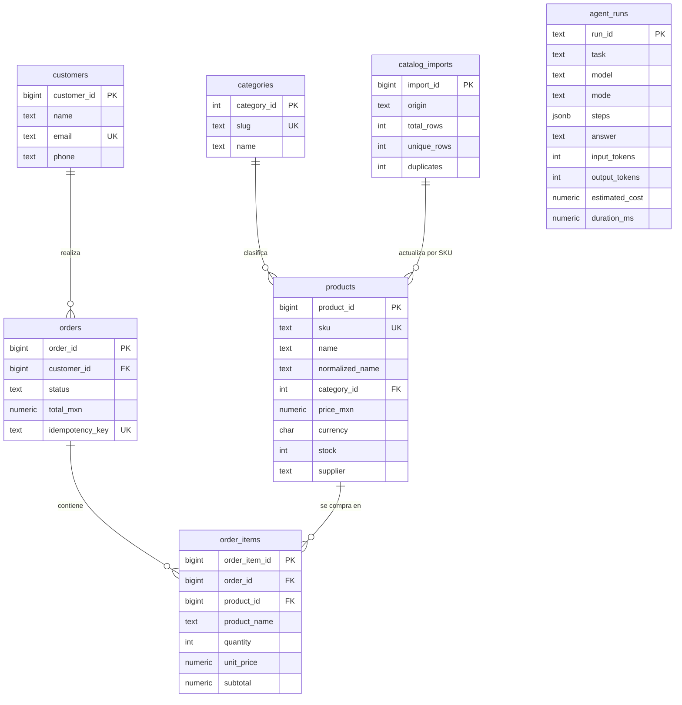
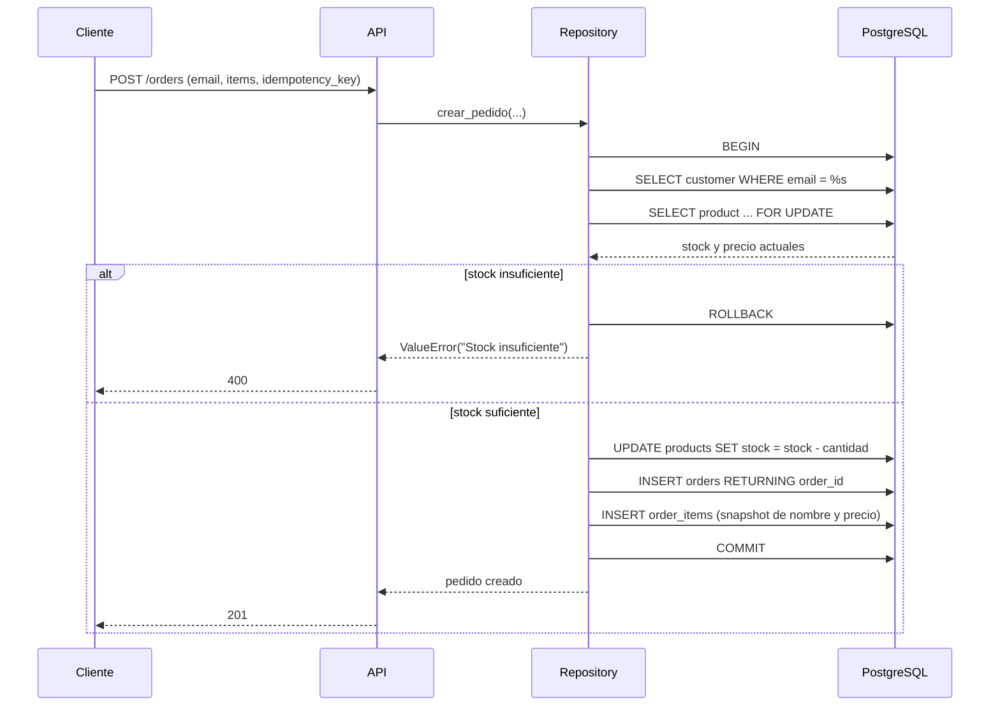
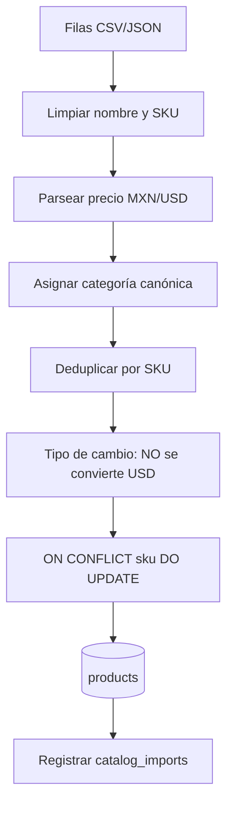

# Arquitectura

## Objetivo

Demostrar un agente LLM que opera sobre PostgreSQL de forma segura y trazable, detrás de una API
REST. El LLM decide qué herramienta usar; los datos y las reglas críticas viven en SQL y en código
determinista.

## Componentes

### API (`app/factory.py`)

- FastAPI con validación Pydantic.
- `create_app(settings, db, repo)` permite inyectar dependencias en pruebas.
- Endpoints de catálogo, pedidos, agente, webhook, estadísticas y trazas.
- Manejador global de errores que no filtra SQL ni credenciales.

### Agente (`app/agent.py`)

1. Recibe `tarea` y `datos` estructurados.
2. Construye mensajes con el esquema de herramientas.
3. El LLM responde con una o más llamadas.
4. Valida argumentos JSON y ejecuta la herramienta.
5. Devuelve el resultado al LLM y obtiene la respuesta final.
6. Persiste `run_id`, traza, tokens, costo y duración en `agent_runs`.

Límite de pasos (`AGENT_MAX_STEPS`, 6 por defecto) para evitar bucles y controlar costo.
Los errores de herramienta vuelven al modelo como `{"error": ...}`; el bucle no se rompe.

### Herramientas (`app/tools.py`)

- Lista cerrada de 5 herramientas; no hay ejecución de shell ni acceso a archivos.
- `consultar_catalogo`: lectura.
- `crear_pedido`: escritura transaccional.
- `consultar_pedido`: lectura con joins.
- `resumen_ventas`: agregados.
- `normalizar_catalogo`: normalización + upsert.

### Repositorio (`app/repository.py`)

- SQL explícito con parámetros (`%s`), sin concatenación.
- `RealDictCursor` para filas nombradas.
- Conversión de `Decimal` a `float` en el borde de la API.
- Escrituras dentro de `with db.conexion()`, que hace commit o rollback.

### Pool (`app/db.py`)

- `ThreadedConnectionPool` de psycopg2, pensado para los endpoints síncronos de FastAPI
  ejecutados en threadpool.
- `conexion()` toma una conexión, hace commit/rollback y la devuelve al pool.
- `ping()` para health checks.

### PostgreSQL

- Motor relacional con restricciones (`CHECK`, `FOREIGN KEY`, `UNIQUE`).
- Migraciones versionadas en `db/migrations/` aplicadas por `scripts/migrate.py`.
- Semilla idempotente en `db/seed.sql`.
- `JSONB` para la traza del agente.

## Modelo de datos

## Flujo transaccional de un pedido

Puntos clave:

- `SELECT ... FOR UPDATE` bloquea la fila del producto hasta el commit; dos pedidos concurrentes
  no pueden vender el mismo stock.
- Si cualquier línea falla, se revierte todo el pedido.
- `idempotency_key` es `UNIQUE`; repetir la petición devuelve el pedido existente.
- `order_items.product_name` guarda el nombre al momento de la compra.

## Flujo de normalización de catálogo

Reglas:

- Acentos y mayúsculas se normalizan.
- Un precio en USD se marca `requiere_conversion` y **no** se importa sin tasa explícita.
- Un precio inválido se omite y se reporta.
- Un SKU ausente se genera de forma determinista con SHA-1 del nombre normalizado.
- Si el SKU ya existe, se actualiza nombre, categoría, precio, stock y proveedor.
- El duplicado dentro del mismo archivo se queda con la última fila y se contabiliza.

## Migraciones

`scripts/migrate.py`:

1. Crea `schema_migrations` si no existe.
2. Lee `db/migrations/*.sql` en orden.
3. Aplica cada archivo dentro de una transacción.
4. Registra la versión aplicada.

Ventaja: el esquema evoluciona sin perder datos; ver `004_order_item_snapshot.sql` como ejemplo de
migración con backfill antes de `SET NOT NULL`.

## Manejo de fallos

| Fallo | Comportamiento |
|---|---|
| Cliente inexistente | `ValueError` -> 400; sin escrituras |
| SKU inexistente | `ValueError` -> 400; rollback |
| Stock insuficiente | `ValueError` -> 400; rollback; stock intacto |
| Duplicado de idempotencia | Devuelve el pedido existente con `idempotente: true` |
| Fecha inválida en ventas | `ValueError` -> 400 |
| Fila de catálogo inválida | Se omite y se reporta; el resto se importa |
| Webhook sin secreto | 401 |
| Catálogo > 5000 filas | 422 de Pydantic / 400 de normalización |
| Proveedor LLM caído | 502 con mensaje acotado |
| Error inesperado | 500 genérico; detalle solo en logs |

## Escalabilidad (plan, no implementado)

1. PgBouncer delante de PostgreSQL y ajuste del pool por worker.
2. Réplica de lectura para catálogo y reportes.
3. Importación de catálogo por lotes (`COPY` a tabla staging + merge).
4. Cola de trabajos para importaciones y llamadas LLM largas.
5. Índices adicionales según consultas reales (`EXPLAIN ANALYZE`).
6. Particionado de `agent_runs` por fecha si crece.
7. Autenticación, cuotas y rate limiting por cliente.
8. Observabilidad: logs estructurados, métricas y trazas distribuidas.

Nada de esto se presenta como implementado.
