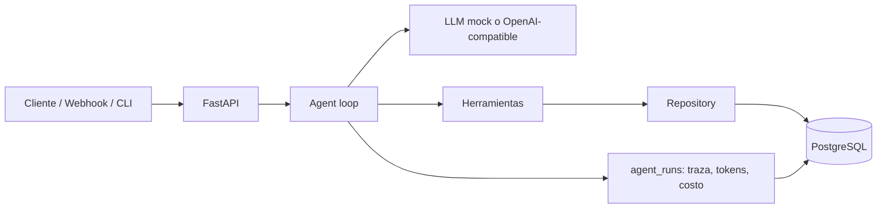

# Agente de operaciones con PostgreSQL y API REST

Demostración técnica de un **agente LLM con function calling** conectado a **PostgreSQL real**,
expuesto mediante una **API REST** con FastAPI, transacciones, migraciones, pruebas automatizadas
y evaluación reproducible.

> **Aviso de honestidad:** es una demostración construida para un proceso de selección.
> **No está en producción**, no opera clientes reales y por defecto usa un LLM simulado (mock)
> sin red ni costo. PostgreSQL sí es real y las pruebas se ejecutan contra él.

## Requisitos que demuestra

| Requisito de la vacante | Cómo se demuestra |
|---|---|
| Agente de IA conectado a PostgreSQL | Bucle de function calling con 5 herramientas que leen y escriben en PostgreSQL |
| API REST | FastAPI con OpenAPI, validación Pydantic, endpoints de catálogo, pedidos, agente y webhook |
| PostgreSQL | Esquema normalizado, migraciones versionadas, transacciones, `SELECT ... FOR UPDATE`, índices, `ON CONFLICT` |
| Normalización de catálogos | Parseo de precios, categorías canónicas, deduplicación, moneda extranjera marcada y upsert por SKU |
| Pruebas y seguridad | 36 pruebas contra PostgreSQL real, casos dorados y pruebas de inyección SQL |
| Defensa técnica | `INTERVIEW.md` con preguntas y respuestas; `DEMO.md` con guion reproducible |

## Resultados verificados (2026-11-11)

- PostgreSQL **18.6** en `127.0.0.1:55432` (instancia local de desarrollo).
- `python -m pytest -q` → **36 passed** contra `agente_test`.
- `python evals/run_evals.py` → **4/4 (100%)**.
- API probada por HTTP real: health, productos, pedido, idempotencia, agente, webhook 401/201 y stats.
- Migraciones aplicadas: `001_init`, `002_catalog_indexes`, `003_product_supplier`, `004_order_item_snapshot`.

## Arquitectura



Flujo del agente:

1. La API recibe `tarea` y `datos` estructurados.
2. El agente envía el esquema de herramientas al LLM.
3. El LLM elige una herramienta y devuelve argumentos JSON.
4. El agente valida los argumentos y los ejecuta contra el repositorio.
5. El repositorio usa SQL parametrizado y transacciones.
6. El resultado vuelve al LLM, que redacta la respuesta.
7. La traza, los tokens y el costo se guardan en `agent_runs`.

## Inicio rápido

### Opción A — PostgreSQL local (Windows + Scoop, la usada en esta máquina)

```bash
scoop install postgresql
PG="$(scoop prefix postgresql)/bin"
"$PG/pg_ctl" -D "$(scoop prefix postgresql)/data" -o "-p 55432" -l "$(scoop prefix postgresql)/postgres-55432.log" start

# Crear rol y bases (si ya existen, omitir)
"$PG/psql" -h 127.0.0.1 -p 55432 -U postgres -d postgres -c "CREATE ROLE agente_app LOGIN;"
"$PG/createdb" -h 127.0.0.1 -p 55432 -U postgres -O agente_app agente
"$PG/createdb" -h 127.0.0.1 -p 55432 -U postgres -O agente_app agente_test

export DATABASE_URL="postgresql://agente_app@127.0.0.1:55432/agente"
export TEST_DATABASE_URL="postgresql://agente_app@127.0.0.1:55432/agente_test"
```

> En desarrollo local el `initdb` de Scoop usa autenticación `trust`. En producción se usa
> `scram-sha-256`, TLS y una contraseña en un gestor de secretos.

### Opción B — Docker Compose (plantilla; Docker no está instalado en esta máquina)

```bash
cp .env.example .env
# Edita POSTGRES_PASSWORD en .env antes de usar
docker compose up --build
```

### Instalar, migrar y probar

```bash
python -m venv .venv
source .venv/Scripts/activate      # Git Bash en Windows
pip install -r requirements.txt

python scripts/migrate.py
python scripts/seed.py

python -m pytest -q
python evals/run_evals.py
```

### Levantar la API

```bash
uvicorn app.main:app --reload
```

- OpenAPI: http://127.0.0.1:8000/docs
- Health: http://127.0.0.1:8000/health

## API REST

| Método | Ruta | Descripción |
|---|---|---|
| GET | `/health` | Estado, conexión PostgreSQL, modo LLM y herramientas |
| GET | `/products` | Catálogo con filtro `categoria` y `limite` |
| GET | `/products/{sku}` | Producto por SKU |
| GET | `/customers` | Clientes |
| POST | `/orders` | Crear pedido con validación de stock e idempotencia |
| GET | `/orders/{id}` | Detalle del pedido con líneas |
| POST | `/agent/run` | Ejecutar el agente |
| POST | `/webhooks/catalog` | Importar catálogo normalizado (secreto compartido) |
| GET | `/stats` | Conteos e ingresos |
| GET | `/runs/{id}` | Traza persistida de una ejecución |
| GET | `/tools` | Esquemas de herramientas |

### Crear un pedido

```bash
curl -X POST http://127.0.0.1:8000/orders \
  -H "Content-Type: application/json" \
  -d '{
    "cliente_email": "laura@example.com",
    "items": [
      {"sku": "BEV-001", "cantidad": 2},
      {"sku": "ALI-001", "cantidad": 1}
    ],
    "idempotency_key": "pedido-001"
  }'
```

Respuesta (resumida):

```json
{
  "order_id": 1,
  "estado": "pending",
  "total_mxn": 523.0,
  "items": [
    {"sku": "BEV-001", "cantidad": 2, "subtotal": 498.0},
    {"sku": "ALI-001", "cantidad": 1, "subtotal": 25.0}
  ],
  "idempotente": false
}
```

Repetir la misma petición con `pedido-001` devuelve el mismo pedido con `"idempotente": true`
y **no descuenta stock dos veces**.

### Ejecutar el agente

```bash
curl -X POST http://127.0.0.1:8000/agent/run \
  -H "Content-Type: application/json" \
  -d '{"tarea": "consultar_catalogo", "datos": {"categoria": "bebidas", "limite": 5}}'
```

### Webhook de catálogo

```bash
curl -X POST http://127.0.0.1:8000/webhooks/catalog \
  -H "Content-Type: application/json" \
  -H "X-Webhook-Secret: $WEBHOOK_SECRET" \
  -d '{
    "origen": "proveedor.csv",
    "filas": [{"sku": "IMP-1", "nombre": "Agua de coco 1 L", "categoria": "Bebidas", "precio": "45.00", "stock": 12}]
  }'
```

Si `WEBHOOK_SECRET` está definido, sin cabecera o con un valor incorrecto responde `401`.

## Herramientas del agente

| Herramienta | Operación en PostgreSQL |
|---|---|
| `consultar_catalogo` | `SELECT` con filtro por categoría e índice |
| `crear_pedido` | Transacción: bloquea productos, valida stock, inserta pedido y líneas, descuenta stock |
| `consultar_pedido` | `SELECT` con join de cliente y líneas |
| `resumen_ventas` | Agregados por rango de fechas y top de productos |
| `normalizar_catalogo` | Normaliza filas y hace `INSERT ... ON CONFLICT (sku) DO UPDATE` |

## Base de datos

```mermaid
erDiagram
    categories ||--o{ products : clasifica
    customers ||--o{ orders : realiza
    orders ||--o{ order_items : contiene
    products ||--o{ order_items : "se compra en"
    catalog_imports ||--o{ products : "actualiza por SKU"

    categories { int category_id PK; text slug; text name }
    customers { bigint customer_id PK; text email; text name }
    products { bigint product_id PK; text sku; numeric price_mxn; int stock }
    orders { bigint order_id PK; bigint customer_id FK; numeric total_mxn; text idempotency_key }
    order_items { bigint order_item_id PK; bigint order_id FK; bigint product_id FK; int quantity; numeric subtotal; text product_name }
    catalog_imports { bigint import_id PK; text origin; int total_rows; int unique_rows }
    agent_runs { text run_id PK; text task; jsonb steps; int input_tokens; int output_tokens }
```

- Migraciones versionadas en `db/migrations/`.
- Semilla idempotente en `db/seed.sql`.
- `order_items.product_name` guarda el nombre del producto al momento de la compra: renombrar
  un producto no altera el historial.
- `agent_runs.steps` es `JSONB` para guardar la traza completa.

## Pruebas

```bash
python -m pytest -q
python evals/run_evals.py
```

Cubren:

- Catálogo, pedidos, stock, rollback, idempotencia y resumen de ventas.
- Normalización e importación de catálogo con upsert.
- Agente mock: herramienta correcta, errores y persistencia de traza.
- API: health, validación Pydantic, 404, 400, webhook y stats.
- Seguridad: inyección SQL en query param y en payload del agente, secreto de webhook,
  rechazo de catálogos gigantes y no filtración de credenciales/SQL.
- Evaluación dorada: 4 casos reproducibles.

## Validación con LLM real

La demo usa `MockLLM` por defecto. El adaptador OpenAI-compatible está implementado, pero **la
llamada real no se ha ejecutado** en esta máquina: no hay credencial dedicada ni precios
configurados que permitan garantizar el presupuesto.

El validador `scripts/validar_llm_real.py` queda preparado con un tope duro de **0.25 USD**:

```bash
# Sin llamada: muestra si falta configuración
python scripts/validar_llm_real.py

# Con credencial autorizada, precios y presupuesto aprobado:
python scripts/validar_llm_real.py --ejecutar
```

Exige `LLM_BASE_URL`, `LLM_MODEL`, `LLM_API_KEY`, `LLM_PRICE_IN_PER_MTOK` y
`LLM_PRICE_OUT_PER_MTOK`; solo permite la herramienta de lectura `consultar_catalogo` y escribe un
reporte sin claves en `evals/llm_real_reporte.json` (ignorado por Git).

## Seguridad

- **SQL parametrizado** en todas las consultas; no se concatenan valores.
- **Prueba de inyección**: `bebidas'; DROP TABLE products; --` devuelve vacío y las tablas siguen intactas.
- **Transacciones**: si falla una línea por stock, se revierte todo el pedido.
- **Idempotencia**: clave única en `orders` + verificación previa.
- **Webhook**: secreto compartido con `hmac.compare_digest`.
- **Validación Pydantic**: emails, cantidades, límites de líneas y tamaño de catálogo.
- **Secretos por entorno**: `.env` está en `.gitignore`; el health no expone credenciales.
- **Sin autenticación de usuarios en la demo**: se documenta como pendiente para producción.

## Licencias

El código de este proyecto **no incluye un archivo LICENSE**; se mantiene sin licencia de
reutilización y todos los derechos quedan reservados hasta que el autor decida otra cosa. Las
dependencias de terceros conservan sus propias licencias (FastAPI MIT, Uvicorn BSD-3-Clause,
Pydantic MIT, psycopg2 LGPL con excepciones, httpx BSD-3-Clause, pytest MIT). Ver
[THIRD_PARTY_LICENSES.md](THIRD_PARTY_LICENSES.md).

## Estructura

```
postgres-ai-agent/
├── app/
│   ├── agent.py          # bucle LLM + herramientas + traza
│   ├── cli.py            # demo por consola
│   ├── config.py         # variables de entorno
│   ├── db.py             # pool de conexiones
│   ├── factory.py        # app FastAPI inyectable
│   ├── llm.py            # mock + OpenAI-compatible
│   ├── main.py           # instancia uvicorn
│   ├── normalization.py  # normalización determinista
│   ├── repository.py     # SQL y transacciones
│   ├── schemas.py        # Pydantic
│   └── tools.py          # contrato y ejecución de herramientas
├── db/migrations/        # 001..004
├── db/seed.sql
├── scripts/              # migrate, seed, check_db, reset_demo, validar_llm_real
├── tests/                # 36 pruebas contra PostgreSQL real
├── evals/                # casos dorados + runner
├── examples/             # pedido JSON y catálogo CSV
├── Dockerfile
├── docker-compose.yml
├── THIRD_PARTY_LICENSES.md
└── docs: ARCHITECTURE.md, DECISIONS.md, DEMO.md, INTERVIEW.md, COSTS.md
```

## Limitaciones

- Demostración, no sistema productivo: falta autenticación, autorización, rate limiting,
  observabilidad centralizada y backups.
- El modo mock no comprende lenguaje libre; el modo real está implementado pero no se midió aquí.
- La normalización se probó con catálogos pequeños; para decenas de miles de filas haría falta
  carga por lotes, índices adicionales y una cola de trabajos.
- Docker Compose es una plantilla no ejecutada en esta máquina (Docker no instalado).
- La instancia local usa autenticación `trust`; producción debe usar `scram-sha-256` y TLS.

## Documentación

- [ARCHITECTURE.md](ARCHITECTURE.md) — diseño, ER, flujos y escalabilidad.
- [DECISIONS.md](DECISIONS.md) — decisiones y trade-offs.
- [DEMO.md](DEMO.md) — guion de demostración reproducible.
- [INTERVIEW.md](INTERVIEW.md) — cómo explicar y defender el proyecto.
- [COSTS.md](COSTS.md) — costos sin cifras inventadas.
- [THIRD_PARTY_LICENSES.md](THIRD_PARTY_LICENSES.md) — licencias de dependencias y estado del LICENSE.
